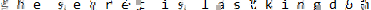

J'ai testé pas mal de truc de steganography mais rien trouvé.

Il faut plutôt utiliser un outil pour dé-pixéliser l'image. Il y en a plein sur github mais celui que j'utilise est :
https://github.com/spipm/Depixelization_poc

Le script oblige de fournir l'image (évidemment) via le paramètre p et l'image de comparaison des caractères (fournis sous images/searchimages)

J'ai donc lancé la commande:
python ./Depixelization_poc/depix.py -p c37e41cc683286f398a1b2eb195998ab.png -s ./Depixelization_poc/images/searchimages/debruinseq_notepad_Windows10_closeAndSpaced.png

Ca retourne ca

The secret is lastkingdom