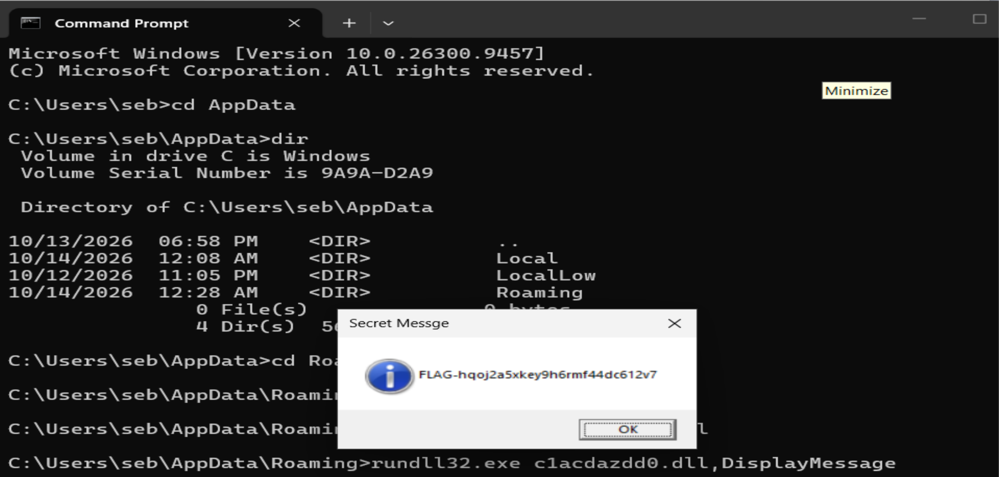

J'ai décompilé l'exe et demandé à un AI de m'expliquer ce que faisait le code source.

Apparemment un fichier dll avec des caractères aléatoire est écrit sous:
C:\Users\Nom\AppData\Roaming

Il existe plusieurs moyens d'inspecter un fichier dll pour trouver une fonction intéressante. Notamment via Ghidra ou même des outils en ligne de viewer ...

On a une méthode DisplayMessage exposé qu'on peut appeler avec rundll32.exe

FLAG-hqoj2a5xkey9h6rmf44dc612v7