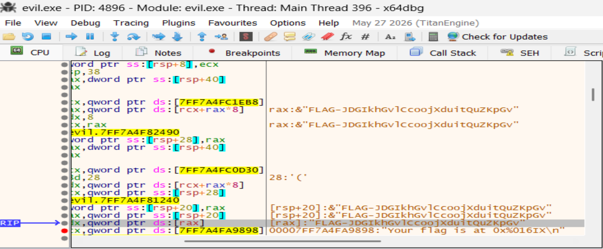

J'ai un fichier exécutable PE32+ executable (console) x86-64, for MS Windows, celui ci indique où sont disposés les flags en mémoire. Je l'ai décompilé avec binary ninja pour comprendre ce qu'il se passait globalement. En gros on a 5 levels différents. 

Dans la première partie (level 1), on veut afficher le contenu d'une adresse mémoire mais le script se ferme et on ne peut pas voir le contenu de la mémoire pendant l'exécution. À moins d'utiliser un debugger, du genre x64dbg de windows.

Je m'y connais aucunement avec ce debuggeur... j'ai cependant trouvé qu'avec un clique droit Search for -> Current Model -> String references, il appraissait les différents adresses des strings Level X. J'ai double cliqué sur celui du level 1 puis mis un breakpoint. Le code assembleur est un peu compliqué à lire mais essentiellement le code C associé ressemble à :

```c
int64_t sub_140005960()
{
    data_140041eb8 = 0x34125632ab3f8522;
    sub_1400031f0(&data_140041f00, "[*] Level 1... ");
    
    if (!IsDebuggerPresent())
        return sub_140005760(1);
    
    OutputDebugStringA("I see you, hacker!\n");
    exit(0x7001a7e);
    /* no return */
}
```
Donc on veut entrer ici return sub_140005760(1);

Par contre on utilise un debuggeur donc IsDebuggerPresent() == true

Alors de là juste autour de la comparaison ```test eax eax ``` et le ```je``` juste après, j'ai modifié le registre rip (qui indique à quelle adresse la commande actuelle se situe) pour l'adresse directement sur laquelle le ```je``` s'effectuait. De là, je vois ```mov ecx,1``` suivi d'un ```call``` ce qui ressemble fortement à sub_140005760(1).

J'ai fais un step in dans le call, puis j'ai avancé jusqu'à ce que je vois mon registre rax se remplir avec le flag



FLAG-JDGIKhGvlCcoojXduitQuZKpGv
