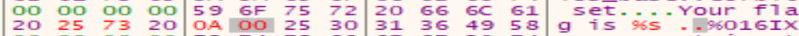
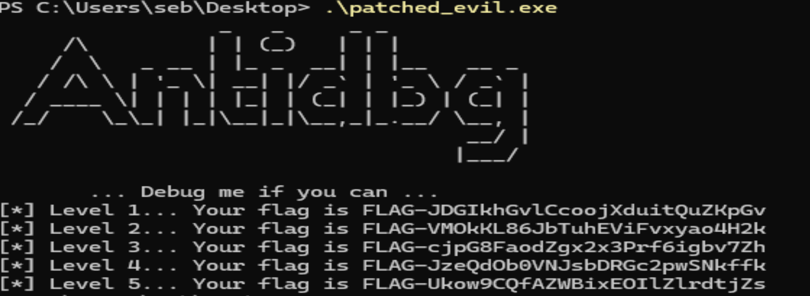

J'ai fini par réaliser que chaque fonction appelle le printf de l'adresse du flag.

comme suit:
```c
printf("Your flag is at 0x%016IX\n", *rax_8);
```

Je n'ai qu'à changer ce print dans le memory dump pour y mettre %s et ca va afficher le flag de la partie 1 jusqu'à 5.



Les 5 flags avec le code patché affichant le contenu plutôt que les adresses mémoires.



FLAG-JDGIkhGvlCcoojXduitQuZKpGv
FLAG-VMOkKL86JbTuhEViFvxyao4H2k
FLAG-cjpG8FaodZgx2x3Prf6igbv7Zh
FLAG-JzeQdOb0VNJsbDRGc2pwSNkffk
FLAG-Ukow9CQfAZWBixEOIlZlrdtjZs
